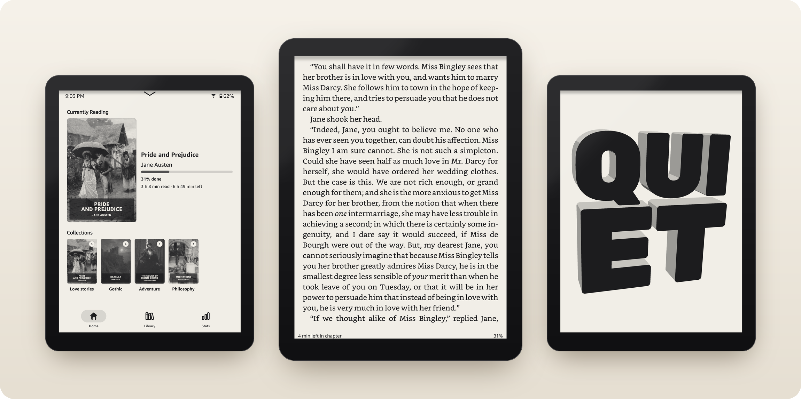
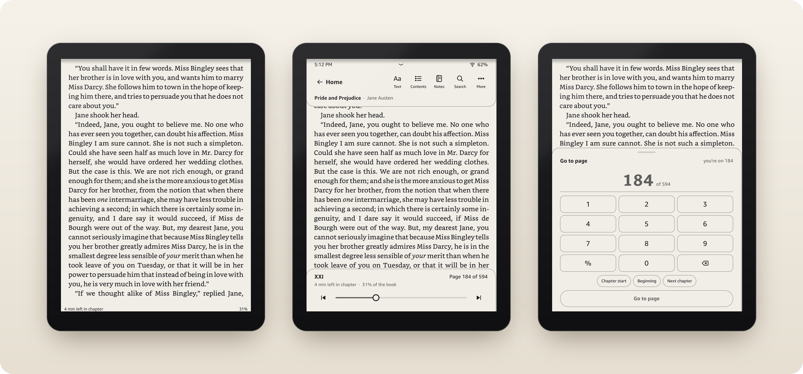
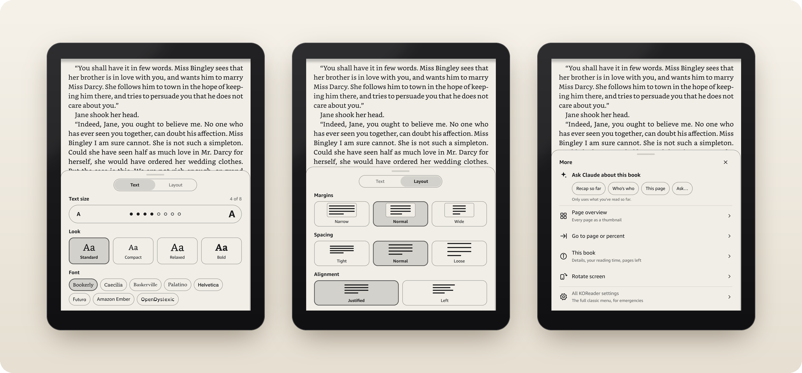
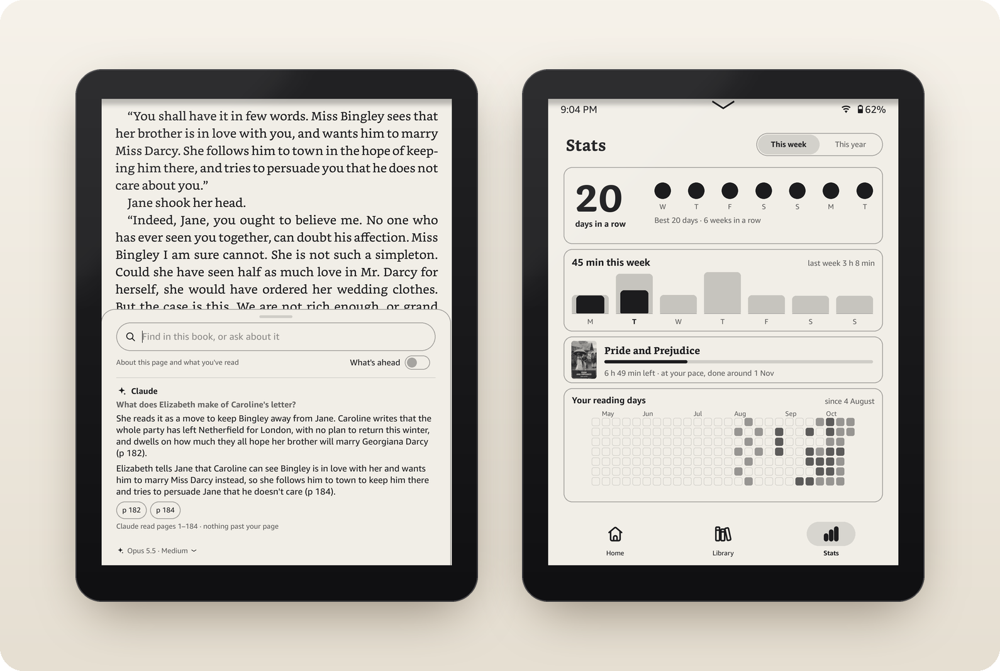
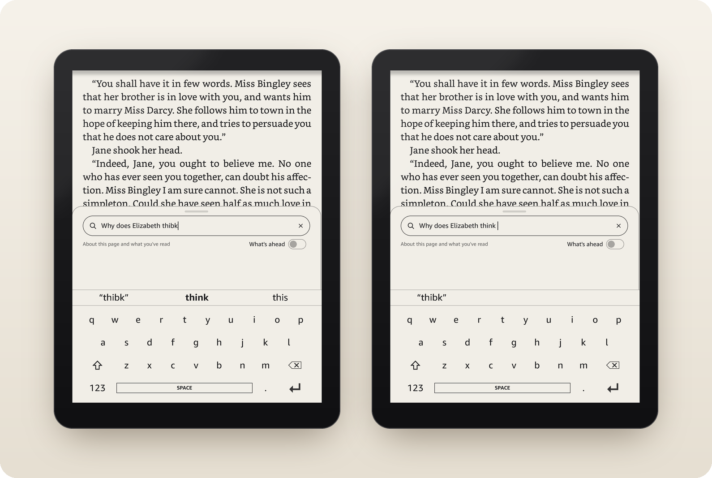

> **WelshWT Paperwhite 3 fork — experimental.** Read [the field guide](PAPERWHITE3.md), [web version](https://welshwt.github.io/quiet-kindle/) and [test status](TESTING-PAPERWHITE3.md) before applying this branch. Home, Exit and library changes need device acceptance checks; cover indexing is unresolved. Original upstream README follows.

# Quiet for Kindle

**A calm, fast, Kindle-like reading UI for KOReader on a jailbroken Kindle Paperwhite.** Quiet cuts KOReader's flood
of menus down to a small, research-backed set that works the way the Kindle's own reader does, makes it faster than
stock, gives you a smooth automatic front light through the Kindle's own light sensor, and adds Ask: questions about
the page, a passage or the whole book, answered by Claude or any OpenAI-compatible model, without spoilers.



<!-- Demo video: drag the .mp4 into this spot when editing README.md on GitHub (it uploads it and inserts the link),
     or replace this comment with a link to the video. -->

> Not affiliated with or endorsed by Amazon, KOReader or SimpleUI. Jailbreaking can void your warranty and, done
> wrong, can brick a Kindle; Quiet comes with no warranty (see [License](#license-and-credits)). Back up first.

## Why

Android TV owners have been debloating their boxes: stripping out the launcher ads, the recommendations and the
services they never asked for, until the thing just plays video. Omarchy treats a Linux desktop as malleable: the
whole system is plain files you (or your AI agent) can read, change and undo. Quiet is both ideas applied to an
e-reader.

KOReader is a superb reading engine with a menu for everything: 7 tabs and 172+ entries in the reading menu alone, 29
text controls, a 13-button selection pop-up. Quiet keeps the engine and puts a Kindle-shaped front on it: five
labelled toolbar buttons, the Kindle's own Aa set (size, Looks, font, margins, spacing, alignment), Home / Library /
Stats tabs, and nothing else on the page. Everything finer is a small versioned file in this repo rather than a
menu: ask your AI agent for "narrower margins" and it adds a change file, pushes it, and can undo it later. The
choices and the research behind them are in [docs/design.md](docs/design.md).

## What you get

**Home and Library.** The book you're reading, with how much you've read and an honest time left to the end of the
story; your collections; the Library as a list or a cover grid, sorted by Recent, Date added, Title, Author or
Series, with search, Hide read and the Kindle Store. Books bought from Amazon show up too and open in Amazon's own
reader.


**Reading.** Bookerly with researched size, spacing and margins. A tap on the top band brings the toolbar and the page
scrubber; "Page 184 of 594" opens a keypad to go anywhere.



**Text and More.** The Kindle's Aa menu in two tabs: text size, four one-tap Looks and the font; margins, spacing
and alignment, drawn as little pages. One set for every book, as on a Kindle. More has Ask about the book.



**Search & Ask and Stats.** Find words offline, or ask an AI about the book: answers cite their pages and never read
past yours unless "What's ahead" is on; questions about the book itself (its series, its author) get answered too,
still without spoilers. Stats shows your streak, this week, the current book and every reading day.



**The Kindle's keyboard.** Every text field types on a copy of Amazon's own keyboard: its layout, read from the
Kindle itself, with accents on a long press. A key shows as pressed the moment your finger lands, two fingers
typing fast no longer lose letters, and the text doesn't flash as you type. Above the keys, word suggestions; a
slip ("teh", "keybaord", a tap that landed between two keys) is fixed when you press space, decided the way Google's
keyboard decides it, and one backspace takes the fix back. Names, the book's own words and the way you write
("rn", "idk") are left alone.



**Sleep screens.** Five QUIET covers (light or dark, or Shuffle between them), the book you're reading with its
progress, or the page you left behind frosted glass, chosen from the pull-down sheet.


**Light and sleep.** Pull down from the top anywhere: brightness, warmth, Auto light, Wi-Fi, night mode, rotation,
sleep, and the sleep screen's picker. Auto reads the Kindle's light sensor, follows the room smoothly instead of in
steps, isn't fooled by your hand's shadow, and learns from the changes you make.


**Faster than stock.** Opening a book from Home ~850 → ~490 ms, back to Home ~900 → ~600 ms, a Look change in one
re-layout instead of up to seven; measured on the device (see [Speed](#speed)).

<sub>Screenshots: KOReader 2026.07.1's emulator at the Paperwhite's 1272×1696 with this repo's patches and plugins
(the keyboard: the Kindle itself), public-domain books from Standard Ebooks, and demo reading stats; the AI answer is
a sample. Framed by
`tools/readme-shots/compose.py`.</sub>

## Requirements

- A **jailbroken Kindle with KOReader** installed. Quiet doesn't jailbreak anything: see
  [kindlemodding.org](https://kindlemodding.org) and
  [KOReader's Kindle guide](https://github.com/koreader/koreader/wiki/Installation-on-Kindle-devices).
- Made and tested on a **Kindle Paperwhite 12th gen Signature Edition** (1272×1696, firmware 5.19.6) with **KOReader
  2026.07.1** and **SimpleUI 2.7.5**. Other recent Kindles should work; older KOReader versions may not.
- [SimpleUI 2.7.5](https://github.com/doctorhetfield-cmd/simpleui.koplugin/releases/tag/2.7.5), the KOReader plugin
  Quiet builds on (installed as part of [Install](#install)).
- A computer and a USB cable. For Ask, optionally, an API key for Claude or any OpenAI-compatible service, or a local
  model (Ollama, LM Studio). Without one everything else works and search stays offline.

## Install

### With an AI agent

Plug the Kindle in and give your agent (Claude Code, Codex, Cursor…) the link to this repo with "set my Kindle up
with this". [AGENTS.md](AGENTS.md) walks it through checking your Kindle, backing up, adding SimpleUI, copying Quiet
and, if you want, setting up an AI for Search & Ask, asking you before each step that changes the Kindle.

### By hand

With the Kindle on USB (KOReader is closed while it's a drive; call the drive `$KINDLE`):

1. **Back up** `$KINDLE/koreader/settings.reader.lua`, `$KINDLE/koreader/settings/`,
   `$KINDLE/koreader/defaults.custom.lua` (if there is one) and the books' `.sdr` folders under `$KINDLE/documents/`:
   `rsync -a --prune-empty-dirs --include='*/' --include='*.sdr/**' --exclude='*' "$KINDLE/documents/" backup/documents/`
2. **Install SimpleUI 2.7.5:** unzip
   [simpleui.koplugin.zip](https://github.com/doctorhetfield-cmd/simpleui.koplugin/releases/download/2.7.5/simpleui.koplugin.zip)
   into `$KINDLE/koreader/plugins/`.
3. **Copy Quiet:** `kindle/` here mirrors `koreader/` on the Kindle. `rsync -rt kindle/ "$KINDLE/koreader/"` (or copy
   the folders over, merging).
4. **Optional, an AI for Ask:** create `$KINDLE/koreader/settings/quiet/keys.lua`, see [Your keys](#your-keys).
5. **Start it:** eject, unplug, and start KOReader as usual (e.g. KUAL > KOReader). The first start applies Quiet's
   settings changes and takes a few seconds longer; KOReader opens on Home with Home / Library / Stats at the bottom.
   `$KINDLE/koreader/settings/quiet/log.txt` says what applied.

Things to know: Quiet sets one text layout for every book (it clears per-book font and layout overrides on its first
start), sets KOReader's tap zones to the Kindle's, and switches off KOReader plugins it doesn't use to make screens
faster (change `011`: calibre, OPDS, progress sync, Wallabag, News downloader, cloud storage and others). Turn any of
them back on in All KOReader settings > Tools > More tools > Plugin management. The optional dictionaries (WordNet,
GCIDE) aren't in the repo; the download links are under "How it works" below.

**Updating:** pull this repo and copy `kindle/` again. Changes already applied aren't applied twice, and settings you
changed on the Kindle stay yours.

### Uninstall

With the Kindle on USB, delete from `$KINDLE/koreader/`: `patches/1-quiet-changes.lua`, every
`patches/2-quiet-*.lua`, `patches/8-quiet-exit.lua`, `patches/quiet-amazon-guard.sh`, `patches/quiet-decoder.lua`,
`patches/quiet-words.lua`, `data/quiet-keyboard/`, `cache/quiet-keyboard-words.bin`, and the plugins
`quiet.koplugin`, `quiethome.koplugin` and `quietstats.koplugin` (and `simpleui.koplugin` if you don't want it).
Then put your backup back: `settings.reader.lua`, `settings/`, `defaults.custom.lua` (or delete Quiet's if you had
none), and the `.sdr` folders (`rsync -a backup/documents/ "$KINDLE/documents/"`). If you turned on booting straight
into KOReader, run `bin/kboot off` first. To take back a single setting instead, add an undo change (see "How a
change gets to the Kindle").

## Your keys

Keys are optional and live only on your Kindle, in `koreader/settings/quiet/keys.lua`, never in this repo:

```lua
-- Claude, through Anthropic's API
return { anthropic = "sk-ant-..." }
```

```lua
-- any OpenAI-compatible chat API: OpenAI, OpenRouter, Groq, Gemini's OpenAI endpoint, Mistral,
-- or a local Ollama / LM Studio (http://<that computer's address>:11434/v1, no key)
return { ai = { url = "https://api.openai.com/v1", key = "sk-...", model = "<a model id>",
                name = "ChatGPT", book_tokens = 30000 } }
```

Add `jev = "..."` for TypeSafe's Jev, which finds described moments ("the scene at the ball") by meaning, even
without an AI. The full format is at the top of `kindle/plugins/quiet.koplugin/quiet_keys.lua`.

What leaves the Kindle, and only when you ask: your question and the book text it needs (the chapters before yours,
up to about 100k tokens, and your chapter up to your page; nothing past it unless "What's ahead" is on) go straight
to the service you chose, over HTTPS with its certificate checked against KOReader's own CA bundle. Quiet has no
server, no analytics and no telemetry. `.gitignore` and the agent guide keep keys out of the repo; `bin/kkeys` copies
keys from your computer (`$QUIET_KEYS_DIR`, default `~/.config/quiet-kindle`) to the Kindle over ssh's stdin without
printing them.

## Working on it

Quiet is built to be changed. Every setting it makes is a change file in `kindle/settings/quiet/changes/`, applied
once, in order, and undoable; the `bin/` tools push changes over Wi-Fi, take screenshots and tap the screen, so an AI
agent can make a change and check it on the device. [CLAUDE.md](CLAUDE.md) has the house rules for agents. They
need SSH to the Kindle (KOReader's SSH server or USBNetwork) as the host `kindle` in `~/.ssh/config`;
`KINDLE_HOSTS="kindle kindle-vpn"` tries several in turn.

## How it works

### How a change gets to the Kindle

`kindle/` mirrors `/mnt/us/koreader/` on the device. `bin/kpush` copies it over SSH and asks KOReader to
restart; KOReader saves the open book first and reopens it afterwards.

- `kindle/settings/quiet/changes/NNN-name.lua` — one change each, applied **once**, in name order, by the
  early patch `kindle/patches/1-quiet-changes.lua` before KOReader reads any settings. Sections: `reader`
  (settings.reader.lua), `simpleui`, `gestures`, `file:<path>`, `books = { strip = {...} }`. Dotted keys reach
  nested tables; `"__delete__"` removes a key; `["sql:<db>"] = { "…;" }` runs SQL on a database in one
  transaction (backed up first with sqlite's own `.backup`, WAL included; no VACUUM; a book's totals are recounted
  through KOReader's `page_stat` view, as its statistics do). What a change replaced is saved on the Kindle in
  `settings/quiet/undo/<id>.lua`; a new change `{ undo = "<id>" }` puts it back. Every file is written whole,
  checked and renamed in; a file that can't be read stops the change, which stays pending (`settings/quiet/log.txt`).
  Book-settings work (strips, `file:` sections naming a book's sidecar, their undos) assumes each book's settings
  live only in its own `.sdr` folder, KOReader's default: if KOReader's `docsettings/` or `hashdocsettings/`
  folders are ever used, review findings C1-F6/F7 apply and the applier needs its "which copy KOReader reads" work
  first.
- `kindle/patches/2-quiet-bridge.lua` — reads `/tmp/quiet-cmd`: `restart`, `flush`, `status`, `open <file>`,
  `event <Name>`, `lua <code>` (debugging). A request is one whole line `@<id> <command>` (a line without its
  newline is never run), answered in `/tmp/quiet-ack.<id>`. `open` answers once the book is really open; `flush`
  means KOReader was asked to save, `event` that the event was sent. It looks every 2 s while it's being used and
  every 20 s after 10 idle minutes: it is the only thing that wakes KOReader while you read.
- `kindle/patches/2-quiet-soft.lua` — one soft shape system for SimpleUI and the library: a plain tab bar under a
  hairline whose active tab is a soft pill behind its filled icon (change 030), rounded covers and progress bars.
- `kindle/patches/2-quiet-speed.lua` — measured speed fixes (see Speed below); `8-quiet-exit.lua` resumes
  Amazon's status bar and gives Amazon its automatic light back when KOReader exits.
- `kindle/patches/2-quiet-light.lua` — the automatic front light (Auto on the Light sheet): reads the light
  sensor itself, shadow-proof, smooth, learns from hand changes. Over SSH:
  `bin/kcmd 'lua return require("quiet_autolight").debug()'`, and `.forget()` to drop what it learned.
  Amazon's own auto light and status bar belong to `quiet-amazon-guard.sh` (`takeover`, `giveback`, `watch`, one
  lock): while KOReader runs, Amazon's auto is off (even with Quiet's Auto off) and its status bar paused, and a
  crash watcher gives both back if KOReader dies. A takeover that fails (exit 2-6) means no Quiet Auto for that
  session; `debug()` shows `running=` and `takeover=` (the raw status: exit code × 256). Each KOReader restart
  briefly lets Amazon's auto move the light (5 → 7 → 5).
- `kindle/patches/2-quiet-home.lua` — the top edge of Home, Library and Stats opens the same Light sheet as in a
  book; KOReader's classic menu is under "All KOReader settings" at its bottom left, Amazon's own Kindle home
  (Store, Amazon's settings) under "Kindle home" at its bottom right (leaves KOReader, no automatic return).
- `kindle/patches/2-quiet-library.lua` — the Library as a list (cover, title, author · series, one progress
  line: "5% · 12 h left", "Finished · May") with a grid/list switch in its header; the choice is remembered
  (CoverBrowser's display mode). The grid keeps `2-quiet-soft.lua`'s look, covers at full strength (change 025
  turned off SimpleUI's fading of finished books). The header's left side has a labelled Store button
  (`quiethome.koplugin/qh_sheets.lua`): "Shop in the Kindle Store" and "Kindle home & settings". Next to the
  switch, Sort opens a sheet of five orders for the list and the grid: Recent (last opened first), Date added
  (newest first), Title (A to Z, a leading "The" left out), Author (by last name, each author's series in order)
  and Series (each series in order, then the rest). They are KOReader collates, kept with its settings (change 031
  starts on Title), so file search follows them too. Left of Sort, "Hide read" leaves finished books out of the
  list and the grid (Amazon's too); it is KOReader's own status filter, so it is remembered, and file search still
  finds read books. The header has no "Library" title (change 026: the Library tab says where you are); in its
  room, search is a wide field whose hint is the longest that fits ("Search books").
- Kindle Store books in the Library (`quiethome.koplugin/qh_library.lua`): Amazon's own books (KFX/DRM, only
  Amazon's reader opens them) are virtual entries among the real ones, sorted with them (by their download for
  Date added, and in a series read from Amazon's title, "…: Sherlock Holmes, Book 5"), marked with a ↗ badge
  and "Opens in Amazon's reader ↗"; tap opens the book there, hold explains. Nothing is written to documents/.
- `kindle/patches/2-quiet-keyboard.lua` (change 032) — KOReader's on-screen keyboard gives way to a copy of the
  Kindle's, for every text field. Its layout is the Kindle's own keymap for the screen
  (`/usr/share/keyboard/en_US/en_US-1272x1696.keymap.gz`) and its icons come from `/usr/share/keyboard/images`,
  both read on the device, so nothing of Amazon's is in this repo. The behaviour is libkb's, read with REA: a key
  is framed when the finger lands and types when it lifts, a slide moves the frame, a lift that slipped onto the
  next key within 300 ms still types the first, a second finger types both keys in the order they landed, a 400 ms
  hold opens the accents (or repeats backspace: 400 ms, then 200 ms, then whole words), and Shift is one capital,
  again for Caps lock. Touches that start on the keyboard are taken before KOReader's gesture detector (so two
  fingers aren't read as a pinch), by tracking id; all others pass through untouched. The frame is drawn straight
  to the screen as four A2 strips. Devices without a keymap for their screen, and non-English keyboards, keep
  KOReader's keyboard. Typed text goes out as DU (KOReader's "ui" is AUTO, which picks the flashing GC16 for grey
  text edges: the "flashing box"), every redraw inside the field, cursor and line included, and one REAGL update
  smooths the letters after a 2 s pause.
  Word suggestions and corrections (change 033): a decoder made the way Google describes Gboard's ("Mobile
  Keyboard Input Decoding with Finite-State Transducers", 2017), in plain LuaJIT (`patches/quiet-decoder.lua`), in a
  process of its own (`patches/quiet-words.lua`, started with KOReader's luajit 8 s after KOReader). Each tap counts
  against every letter by its distance from the key's centre (a Gaussian, from where the finger landed), letters left
  out or extra and swapped taps cost a little, and each word by its frequency in AOSP's keyboard word list (US and
  British English, 165,000 words: `data/quiet-keyboard/en.words.gz`, made by `tools/keyboard-words/make_words.py`;
  Apache-2.0, see NOTICE). The word as typed is scored too, as a word or as an unknown one, and a correction must beat
  it by a margin. A real word, or one of four letters or fewer, changes only by slips onto neighbouring keys or two
  swapped letters ("rn", "omg", "hmm" stay); a capital makes an unknown word cheap to keep (names). The list is
  searched as a trie, a beam of 64 prefixes per tap, and mapped from a cache built on first use
  (`cache/quiet-keyboard-words.bin`, ~11 MB): the helper keeps ~3 MB of its own. It is asked on every key (answers
  are read only when poll() says so: a stuck helper can't hold KOReader up; one that doesn't answer in 3 s is
  restarted), and a row of three words above the keys is drawn by DU once typing pauses for 0.3 s, the likeliest in
  the middle. A space (or . , ? ! : ; or return) types the bold middle word, the correction, when there is one; the
  left one, in quotes, keeps what was typed. Words of the book open in Search & Ask (collected from the pages read,
  in the background), words in the names of the books on the Kindle, words put back before and unknown words typed
  twice as they were are never corrected. Backspace right after a correction takes it back and remembers the word
  (`quiet_keyboard_keep`, 300). Off for passwords and number fields. `tools/keyboard-eval/eval.lua` measures it on
  simulated typing (taps scattered around the keys' centres, 9% on another key): 62% of words right as typed, 93%
  after correction, no dictionary word typed right changed, 34 of 34 informal words and 35 of 40 names from
  public-domain novels kept (every capitalised one; the five changed, typed in lower case, are a letter or two from
  a real word: stubb, fogg).
  `quiet_keyboard_log` (off) writes each decision to `settings/quiet/keyboard.log`, for tuning on the device.
- `kindle/patches/2-quiet-currently.lua` — Home's Currently Reading card: "5% done", then honest time read and
  time left to the end of the story. SimpleUI draws it; the numbers come from `quiet_readtime.lua`.
- `kindle/plugins/quiethome.koplugin` — Amazon's books, read-only from Amazon's catalog `/var/local/cc.db`
  (`qh_store.lua`). The Home card that listed them is off since change 024 (they're in the Library; undo brings
  it back). A book opens straight in Amazon's reader through `quiet.koplugin/quiet_amazon.lua`: KOReader exits (its launcher must give
  the screen and Amazon's services back first), `quiet_amazon_open.sh` then starts
  `app://com.lab126.booklet.reader<percent-encoded path>` and, when Amazon's home or library comes up after the
  book, starts KOReader again. Leaving closes every KOReader window (search results too). One-shot: KOReader is the
  only writer of the latest request (`/tmp/quiet-amazon.req`) and the helper acts only on its own, so a late helper
  never touches a later session (log `/tmp/quiet-amazon.log`). About 14 s to the book, 6 s back.
- Sleep screens (`quiet.koplugin/quiet_sleep.lua`, `quiet_sleepsheet.lua`, `patches/2-quiet-sleep.lua`, change
  027): instead of KOReader's "Sleeping" box, one of five QUIET covers (Block, Big Q, 3D block, 3D Q, Diagonal;
  light or dark, Shuffle takes them in turns), the book you're reading (Book cover), or the screen as it was behind
  frosted glass (Frosted). Chosen in the Sleep screen sheet, from the Sleep screen row of the pull-down sheet. The
  covers are made ahead by `tools/sleep-covers/make_covers.py` (Rubik Black, OFL, from Google Fonts; real 3D
  extrusions with flat greys) into `kindle/data/quiet-sleep/`. KOReader's screensaver shows the image, so every way
  to sleep is the same; waking keeps you where you were (SimpleUI no longer closes Home under the sleep screen or
  jumps to Home on wake). The CPU runs at full speed for that second (it idles at under a third). Measured from a
  real press while idle: a QUIET cover 5-10 ms to make (~35 ms for a new one, e.g. each Shuffle), Book cover ~55 ms
  (its scaled cover is kept on disk in `cache/quiet-sleep/`; only the very first sleep with a book reads it out of
  the book, ~0.4 s), Frosted ~170 ms; the panel starts changing ~0.15 s after the press.
- `kindle/plugins/quietstats.koplugin` — the Stats tab's page (a SimpleUI module on its own custom screen, see
  change 013). Books Amazon's reader finished before KOReader: `qs_amazon_finished.lua` reads them from an optional
  `settings/quiet/amazon_finished.lua` on the Kindle (the format is in that file); none are shipped.
- `kindle/icons/` — icons KOReader and SimpleUI look up by name; ours replace their thin built-ins.
- `kindle/data/dict/` — dictionaries KOReader looks words up in. The dictionary files themselves (25 MB) aren't
  in the repo: WordNet 3 (`http://download.huzheng.org/dict.org/stardict-dictd_www.dict.org_wn-2.4.2.tar.bz2`,
  sha256 27dfc985…) and GCIDE (`http://build.koreader.rocks/download/dict/gcide.tar.gz`, sha256 be3c1293…),
  unpacked into `data/dict/WordNet` and `data/dict/GCIDE`. What is here: WordNet's formatter (`.lua`, `.css`)
  and its `.ifo` marked HTML so KOReader runs the formatter.
- `kindle/plugins/quiet.koplugin` — the reading UI: toolbar (tap the top band; its Back follows KOReader's history,
  scrubs included), Text (size, Looks, font; Layout: margins, spacing, alignment, one set for every book) / Light /
  More sheets,
  selection bar, footer words, and the Go to page keypad (`quiet_goto.lua`: tap "Page 9 of 579" on the
  toolbar, or More > Go to page). KOReader's own menus stay under More > All KOReader settings. Also:
  - Search & Ask (toolbar Search, selection bar Ask Claude, More's chips): `quiet_ask.lua` is the sheet,
    `quiet_find.lua` the offline matches (no capitals or accents, numbers and chapter names jump),
    `quiet_bookctx.lua` decides what Claude reads (chapters before yours up to ~100k tokens;
    your chapter up to your page; nothing past it unless "What's ahead" is on; the earlier chapters are cached for
    5 minutes, renewed by each follow-up) and its rules: the story from the text, with pages; the book itself (series,
    reading order, author) from what it knows, never past your page, later books by title only. `quiet_claude.lua` (Opus 5.5 at
    medium effort by default; model and effort under the answer) and `quiet_jev.lua` (TypeSafe's Jev: picks
    the passage closest in meaning, routes "find" vs "ask") run over `quiet_net.lua`: HTTPS in a child process,
    so the page never freezes, with certificates checked against KOReader's own CA bundle (`data/ca-bundle.crt`, part of every KOReader
    install; the firmware's `/etc/ssl/certs` is the fallback). With "What's ahead" off, a
    match's words stop where your page ends; PDF and DjVu search ignore accents too. An answer that stops partway
    keeps what arrived ("Stopped here", Try again); one that runs out of room says "Cut off here", with Go on.
    Wi-Fi is turned on through Amazon's lipc, without a box.
  - `quiet_readtime.lua` — one reading-time rule for Home, Library, footer, toolbar and Stats: your own pace
    (median page time), each page counted at most twice that, so a page left open until the screensaver doesn't
    count as reading. Time left runs to the end of the story, not the end of the file; a closed book's comes from
    its saved position and layout (`quiet_position`).
  - `quiet_finish.lua` — marks a book finished when you turn into its back matter (Acknowledgments, Notes, Index…,
    found from the contents and saved as a position, so text size doesn't move it), with an Undo for 6 s.
    Only a real page turn counts, never a jump, and at least half the story must be read: statistics plus pages
    stayed on for 4 s while awake (time asleep never counts).
- Keys, all optional, in `settings/quiet/keys.lua` on the Kindle (never in this repo): `anthropic` for Claude, or
  `ai = { url, key, model, name, book_tokens }` for any OpenAI-compatible service (`quiet_openai.lua`; it wins when
  both are there), and `jev` for TypeSafe's Jev. Without an AI the ask buttons are hidden and search stays on the
  Kindle, except that a Jev key still finds described moments by meaning (Jev gets those words and nearby text);
  the buttons say the AI's name. `bin/kkeys` copies `api-key` (Claude) and `jev-key` (Jev) from
  `$QUIET_KEYS_DIR` (default `~/.config/quiet-kindle`) there; the full format is at the top of `quiet_keys.lua`.

- `kindle-system/koreader-boot.conf` — boots the Kindle straight into KOReader (an upstart job in /etc/upstart,
  installed and removed with `bin/kboot on|off`): once per boot, after Amazon's home is up. A file named
  `koreader-boot-off` in the Kindle's top folder (create it over USB) skips it.

Because changes apply once, anything you later adjust on the Kindle itself (text size, light) stays.

### Commands

| Command | Does |
|---|---|
| `bin/kpush [--hard] [name]` | copy `kindle/` (md5-checked, staged, one push at a time; a cut-short push changes nothing, "push again" if it says so; deleted files aren't removed), restart KOReader safely, print a screenshot path |
| `bin/kshot [name]` | screenshot into `shots/` (~11 s, the Kindle's capture tool; calls take turns, and it refuses if two new pictures appear at once) |
| `bin/ktap X Y` | tap at full-resolution portrait coordinates (1272x1696); taps and holds take turns |
| `bin/khold X Y [ms [X2 Y2]]` | press and hold (default 1.2 s), optionally drag to X2 Y2 to select text; the finger is lifted even if ssh drops |
| `bin/kcmd status` | what's on screen: `home` or `reader <file>` (first answer after idle can take ~20 s; waits up to 45 s; exits 1 on an error answer) |
| `bin/ktrace on/dump` | time taps, repaints and e-ink updates inside KOReader, in ms |
| `bin/kawake on/off` | keep the Kindle awake or let it sleep: on while an agent works on the Kindle, off when done (a long deep sleep can reset it). It tells KOReader too, as its own Keep alive does: powerd's `preventScreenSaver` alone makes KOReader's auto-suspend spin once its timeout passes |
| `bin/kstack` | KOReader's Lua traceback, read from outside it: for a freeze, when `kcmd` gets no answer (find where it's stuck instead of killing it) |
| `bin/khost` | which ssh host works now: the first of `$KINDLE_HOSTS` (default `kindle`) that answers |
| `bin/kkeys` | put the Claude and Jev keys on the Kindle (prints only which keys it saved) |
| `bin/kboot on/off/status` | boot straight into KOReader, or into Amazon's home again (installed checked and staged, one call at a time; `status` compares the installed job) |

The Kindle must be awake, open in KOReader and unplugged (with a cable in it's in USB mode: no Wi-Fi, no
KOReader).

## Speed

Measured 2026-10-19 on a Paperwhite 12 SE with `bin/ktrace` and timing hooks.

| | before | now | what changed |
|---|---|---|---|
| Open a book from Home | ~850 ms | ~490 ms | External keyboard plugin off (it re-scanned every input device for ~180 ms on each screen); Tailscale plugin's per-screen subprocesses cached; shorter "Opening …" box |
| Book on screen, no "Opening…" box | box at ~80 ms, book at ~650 ms | book at ~650–690 ms, no box | for books opened before: no box and no forced repaint (an invisible stand-in keeps KOReader from quitting while Home has gone); the CPU's lowest speed is raised while the book loads, which the box's screen update used to do by accident (without it, loading took ~150 ms longer) |
| Home from a book | ~900 ms | ~600 ms | same plugin work; SimpleUI's "Closing book…" box gone |
| KOReader restart to book | 4.5 s | 3.9 s | fewer plugins to load |
| Look tile | up to 7 re-layouts | 1, tile shows in ~25 ms | `quiet_looks.lua` batches settings (BatchedUpdate), skips unchanged ones |
| Three quick A taps | 3 re-layouts, taps dropped | dots move in ~20 ms, 1 re-layout | `quiet_text.lua` applies the size 0.4 s after the last tap |
| Idle wake-ups | 0.5/s (bridge poll) | 0.05/s after 10 min | adaptive bridge polling |
| A key, Search & Ask (22 Oct) | shown only after the lift, for 15 ms; text sent ~100 ms after the lift | framed when the finger lands; text sent ~15 ms after the lift, out in ~20 ms | the Kindle's keyboard (`2-quiet-keyboard.lua`); the text no longer waits behind the key's own update |
| Typing past a suggestion | whole sheet (1272×427) redrawn, field jumps, page under it redrawn | only the part under the field redrawn | the sheet keeps its height while typing; chapters read once per sheet, not per key |
| Two fingers overlapping | both letters lost | both typed, in order | touches on the keyboard bypass KOReader's two-finger gestures |
| A letter in a field | "ui" (GC16 here: the changed pixels flash), ~20 ms of KOReader work | DU, no flash, no wait, ~5 ms | every redraw inside the field sent as DU; one REAGL pass after a 2 s pause |
| Word suggestions | none | above the keys after a 0.3 s pause, ~6 ms per word in their own process (15 ms the first) | a Gboard-style decoder on AOSP's word list (change 033) |

A page turn is ~30 ms of KOReader work plus ~205 ms of e-ink waveform (REAGL, the same as Amazon's reader);
that part is hardware. Measure before changing: `bin/ktrace on`, act with `bin/ktap`, then `bin/ktrace dump`.
Note: `ktap` jitters by 1 px because the input core drops a coordinate equal to the previous contact's.

## License and credits

Quiet is free software under the [GNU AGPL-3.0](LICENSE), the license KOReader uses. You may use, change and share it;
if you share a changed version, or run one for others over a network, its source has to be available under the same
license. It comes with **no warranty**: you use it on your own Kindle at your own risk.

- [KOReader](https://github.com/koreader/koreader) (AGPL-3.0) is the reading engine Quiet patches and extends.
- [SimpleUI](https://github.com/doctorhetfield-cmd/simpleui.koplugin) by Doctor Hetfield (2.7.5: MIT) is the home
  screen and tab bar Quiet builds on. Install it from its own project; it isn't copied here.
- WordNet (Princeton University, WordNet License), Rubik (Hubert & Fischer, OFL) for the sleep covers, and Standard
  Ebooks (CC0) for the screenshot books. Details in [NOTICE](NOTICE).

**No Amazon code ships here.** No firmware, binaries, fonts, books or other Amazon files are in this repo. Quiet tunes
KOReader with settings, patches and plugins, and works with the Kindle through the controls its software offers on
the device: lipc properties (light, Wi-Fi, screensaver), app URIs (opening a Store book in Amazon's reader, the
Store), the light sensor, and a read-only look at Amazon's book catalog for the Library. The Kindle's own fonts
(Bookerly, Amazon Ember) are used by name from the device. Quiet doesn't touch DRM: Amazon's books still open only
in Amazon's reader.

Not affiliated with, endorsed by or sponsored by Amazon, KOReader or SimpleUI. Kindle, Paperwhite, Bookerly and
Amazon Ember are trademarks of Amazon.com, Inc. or its affiliates.
